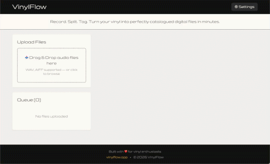
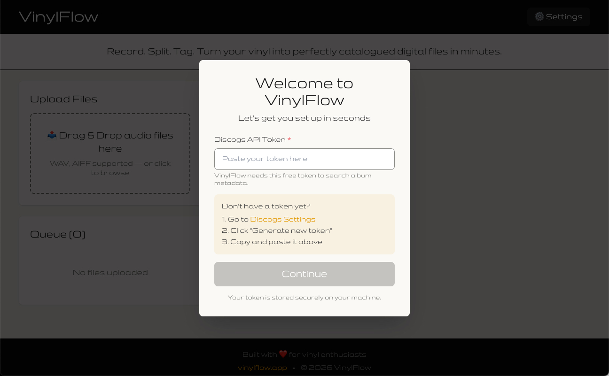

# 🎵 VinylFlow

**Digitize vinyl 10x faster. Open source.**

Turn your vinyl recordings into perfectly tagged, organized digital files in minutes — not hours. VinylFlow automates track splitting, Discogs metadata tagging, cover art embedding, and vinyl-style numbering (A1, A2, B1, B2).



---

## Use VinylFlow

- 🖥️ **Desktop apps:** install builds from [vinylflow.app/install](https://vinylflow.app/install)
- 🐳 **Docker (self-hosted):** run locally via [Quick Start (Docker)](#quick-start-docker)
- ⚙️ **Python local mode:** see [Manual Setup (Non-Docker)](#manual-setup-non-docker)

---

## The Problem

Digitizing a vinyl record manually takes **20–30 minutes per album**: record in Audacity, manually find track boundaries, split, export, look up metadata, type it all in, find cover art, embed it. Multiply that by a collection of hundreds of records and it's a weekend project that never ends.

## The Solution

VinylFlow does it in **3 minutes**. Upload your recording, pick the album from the Discogs results it finds for you, check the detected tracks, and hit process. Done.

---

## Features

- **Automatic silence detection** — intelligently finds track boundaries in your recording
- **Duration-based splitting** — fallback for seamlessly mixed tracks with no gaps
- **Discogs first** — selecting a recording searches Discogs from its file name right away; result cards show artwork, track count, whether Discogs lists track lengths, and how well the lengths fit your recording
- **Multiple output formats** — FLAC (lossless), MP3 (320kbps), or AIFF (lossless)
- **Multiple input formats** — WAV and AIFF recordings supported
- **Import from a folder** — large recordings are read in place from a read-only folder instead of being uploaded through the browser; see [Import from a folder](#import-from-a-folder-no-upload)
- **Vinyl-style numbering** — proper A1, A2, B1, B2 track notation
- **Rich tags** — multi-artist credits keep Discogs' join strings ("Simon & Garfunkel") without disambiguation suffixes ("Nirvana (2)" → "Nirvana", also in folder names), album artist is always set, compilations carry per-track artists and the compilation flag, and unknown values are left out instead of written empty
- **Classical credits** — for releases with the Discogs genre "Classical", composers (from composer credits, else a lone release artist with no performing credit, when the release credits no composer), conductor, ensembles and soloists (allowlisted performing roles only, honouring credit track ranges such as "A1 to A3", also on a suite's movements) are tagged, and ARTIST lists soloists, then ensembles, then the conductor when the credits cover every performer in the artist line (otherwise it stays as Discogs has it); production credits are never written
- **Cover art** — downloads and embeds album artwork automatically
- **Interactive waveform editor** — drag regions to fine-tune track boundaries
- **Batch queue** — process multiple records with real-time progress
- **Remote access** — control from any device on your network (phone, tablet, laptop)

---

## Quick Start (Docker)

**Recommended path:** Docker (stable). If you prefer local Python, see [Manual Setup (Non-Docker)](#manual-setup-non-docker).

### Prerequisites

You'll need:
- **Docker Desktop** (free) — [Download here](https://www.docker.com/products/docker-desktop/)

That's it! Git is optional (see Step 1 below). No need to mess with configuration files — VinylFlow will guide you through setup in your browser.

## 1. Get VinylFlow

### Option A: Download ZIP (easiest — no Git required)

1. Go to [github.com/olimic1000/vinylflow](https://github.com/olimic1000/vinylflow)
2. Click the green **Code** button, then **Download ZIP**
3. Unzip the folder to a location you can find (like your Downloads or Desktop)
4. Open the unzipped `vinylflow` folder

### Option B: Clone with Git (for terminal users)

```bash
git clone https://github.com/olimic1000/vinylflow.git
cd vinylflow
```

## 2. Start VinylFlow

1. **Open your terminal:**
   - **Mac:** Open "Terminal" app (or iTerm)
   - **Windows:** Open "Command Prompt" or "PowerShell"
   - **Linux:** Open your terminal application

2. **Navigate to the VinylFlow folder:**
   - If you downloaded the ZIP, type `cd ` (with a space after) and drag the `vinylflow` folder into the terminal window, then press Enter
   - Or type the full path, like: `cd ~/Downloads/vinylflow` or `cd C:\Users\YourName\Downloads\vinylflow`
   - **Windows shortcut:** In File Explorer, open the vinylflow folder, click the address bar, type `cmd` and press Enter

3. **Start VinylFlow:**
   ```bash
   docker compose up -d
   ```

4. **Open your browser** and go to **http://localhost:8000**

### Accessing from other devices (LAN)

By default the port is published on `127.0.0.1` only, so VinylFlow is reachable just from the computer running it. To open it from a phone or another computer, add `BIND_ADDRESS=0.0.0.0` to your `.env` and run `docker compose up -d` again, then browse to `http://<your-computer's-IP>:8000`. To reach it by a hostname instead of an IP, also add `VINYLFLOW_ALLOWED_HOSTS=<name>` (e.g. `nas.local`) to your `.env`.

**Risk:** VinylFlow has no authentication, and the API can change the output folder and write files there. Anyone who can reach the port can use it, so only enable this on a trusted network.

### Import from a folder (no upload)

A full album recorded at 24-bit/96 kHz is about 1.5 GB, and uploading it through the browser copies it into the container. Instead, put your recordings in the `incoming/` folder next to `docker-compose.yml` (created on first start) and use the **Import from folder** tab: VinylFlow reads them where they are.

- To use a folder you already have, set `IMPORT_FOLDER=/path/to/your/recordings` in `.env` and run `docker compose up -d` again.
- The folder is mounted **read-only**: VinylFlow never modifies, moves or deletes your recordings. Removing a file from the queue (or the automatic temp clean-up) only deletes VinylFlow's own preview and analysis files.
- Subfolders are listed (up to 3 levels). A file that was changed in the last few seconds shows as "Still copying…" until the copy finishes. A file already in the queue can be imported again; it reuses the existing entry. The list marks files "In queue" or "Complete".
- Desktop app: the import folder is `~/Music/VinylFlow/Incoming`, and **Choose files…** opens any WAV/AIFF on your computer in place.
- Running without Docker or the desktop app: set `VINYLFLOW_IMPORT_DIR` to the folder (for example in `.env`). The import folder can't be changed from the web UI.

## 3. First-Run Setup

When you open VinylFlow for the first time, you'll see a welcome screen that guides you through setup in seconds:



1. **Get your free Discogs API token** — Click the link in the setup screen or visit [discogs.com/settings/developers](https://www.discogs.com/settings/developers)
2. **Generate a new token** — Click "Generate new token" on the Discogs settings page
3. **Copy and paste** — Paste your token into VinylFlow's setup screen
4. **Click Continue** — Done! VinylFlow validates the token and you're ready to digitize

**That's it!** 🎵 No hidden files, no terminal commands, no restart needed. Your token is saved securely and persists across Docker restarts.

**Tip:** You can update your token anytime from the Settings (⚙️) menu in VinylFlow.

## Desktop Apps (Beta)

VinylFlow desktop apps are available for macOS and Windows (beta track).

- Installer downloads: [vinylflow.app/install](https://vinylflow.app/install)

- Desktop beta work is published from `desktop-beta`
- `main` remains the stable Docker-first channel
- For local desktop mode, run: `python desktop_launcher.py`
- Packaging/release scripts are in `scripts/`

### Developer Branch Note

To avoid accidental promotion of beta app work:

- Open desktop feature PRs into `desktop-beta`
- Keep `main` for stable/docs/release-safe changes
- Promote desktop work to `main` only when explicitly ready

For full branching and release details, see [docs/BRANCHING_STRATEGY.md](docs/BRANCHING_STRATEGY.md).

---

## Manual Setup (Non-Docker)

For tech-savvy users who prefer managing their own Python environment.

### Prerequisites

You'll need to install these system dependencies first:

- **Python 3.11 or later**
- **FFmpeg** (handles all audio processing and format conversion: MP3, FLAC, AIFF)
- **FLAC encoder** (optional, provides dedicated FLAC encoding tools)
- **libsndfile1** (optional, audio I/O library)

**Installation by OS:**

**macOS** (using Homebrew):
```bash
brew install python@3.11 ffmpeg flac libsndfile
```

**Ubuntu/Debian**:
```bash
sudo apt-get update
sudo apt-get install python3.11 python3.11-venv ffmpeg flac libsndfile1-dev
```

**Windows**:
- Install [Python 3.11+](https://www.python.org/downloads/) (check "Add to PATH" during installation)
- Download [FFmpeg](https://ffmpeg.org/download.html) and add it to your PATH
- FLAC and libsndfile are bundled with FFmpeg on Windows

### Installation Steps

```bash
# 1. Clone the repository
git clone https://github.com/olimic1000/vinylflow.git
cd vinylflow

# 2. Create and activate a Python virtual environment
python3 -m venv venv
source venv/bin/activate  # On Windows: venv\Scripts\activate

# 3. Install Python dependencies
pip install -r requirements.txt

# 4. Start the server
python -m uvicorn backend.api:app --host 0.0.0.0 --port 8000
```

Open **http://localhost:8000** in your browser.

### First-Run Setup (Non-Docker)

Just like with Docker, VinylFlow will show you a welcome screen on first run:

1. Visit [discogs.com/settings/developers](https://www.discogs.com/settings/developers) and generate a free API token
2. Paste it into the VinylFlow setup screen
3. Click Continue — done!

Your token is saved to `config/settings.json` and works immediately without restart.

**Alternative (for advanced users):** You can still use a `.env` file if you prefer:

```bash
cp .env.example .env
```

Edit `.env` and add your token:

```ini
DISCOGS_USER_TOKEN=your_token_here
DEFAULT_OUTPUT_DIR=~/Music/VinylFlow
```

**Notes:**
- The `output/` and `temp_uploads/` directories are created automatically
- To import recordings in place instead of uploading them, add `VINYLFLOW_IMPORT_DIR=~/Music/VinylFlow/Incoming` (or any folder) to `.env`
- You can adjust silence detection and other settings in `.env` (see [Configuration](#configuration) below)
- To stop the server, press `Ctrl+C` in the terminal

---

## How It Works

1. **Add** — import a WAV or AIFF recording from the import folder, or drag and drop it to upload
2. **Pick the release** — VinylFlow searches Discogs from the file name as soon as you select the recording. Result cards fill in their track lists as they load; releases with complete track lengths are marked, and the one whose lengths best fit your recording is flagged "Best fit". Edit the search box to look again. The chosen release stays in a card above the waveform (cover art, a link to Discogs, **Change release**)
3. **Detect** — picking a release starts track detection by silence. No Discogs token, or no good match? Use **Skip Discogs — detect tracks by silence only**; **Try Discogs again** takes you back to the search once tracks exist
4. **Map** — match detected tracks to Discogs track listings
5. **Choose format** — FLAC, MP3, or AIFF output
6. **Process** — tracks are split, converted, tagged, and saved with cover art

Your files appear in the `output/` folder, organized as `Artist - Album/A1-Track Name.flac`.

---

## Output Example

```
output/
└── Aril Brikha - Departure/
    ├── A1-Groove La Chord.flac
    ├── A2-Art Of Vengeance.flac
    ├── B1-Ambiogenesis.flac
    ├── B2-Deeparture In Mars.flac
    └── folder.jpg
```

Each file includes embedded metadata: artist, album, title, track number, year, label, Discogs ID, and cover art.

---

## Who Is This For?

- **DJs** digitizing crate finds for digital sets
- **Vinyl collectors** preserving and cataloguing collections
- **Record labels** archiving back catalogs
- **Music lovers** who want their vinyl in lossless digital

---

## Configuration

**Discogs Token**: Managed via the web UI (Settings ⚙️ menu)

**Audio Processing Settings**: Adjust in the app via Settings (⚙️), or for advanced users, edit `config/settings.json` or `.env`:

```ini
# Silence detection (adjust if tracks aren't splitting correctly)
DEFAULT_SILENCE_THRESHOLD=-40      # dB — increase to -35 if tracks are merging
DEFAULT_MIN_SILENCE_DURATION=1.5   # seconds — decrease to 1.0 for short gaps
DEFAULT_MIN_TRACK_LENGTH=30        # seconds — ignore segments shorter than this

# FLAC compression (0-8, higher = smaller files)
DEFAULT_FLAC_COMPRESSION=8
```

**Config Priority**: `config/settings.json` (UI-editable) → `.env` (manual) → environment variables (Docker)

**Track Numbering**: Configurable via Settings (⚙️) or by setting `TRACK_NUMBERING` in `config/settings.json`:
- `vinyl` — writes the vinyl position (e.g. `A1`, `B2`) directly as `TRACKNUMBER`. Preserves vinyl notation but some players (Jellyfin, Roon) may mis-sort tracks.
- `sequential_disc_per_lp` *(default)* — writes integer `DISCNUMBER` (A+B = disc 1, C+D = disc 2) and sequential `TRACKNUMBER` across both sides of each LP, with track/disc totals (`TRACKTOTAL`/`DISCTOTAL`, or `n/total` in ID3) and the original vinyl position preserved in a `VINYLPOSITION` tag. Numbering follows the release's tracklist, so a side exported on its own continues after side A and a skipped track leaves a gap. Single LPs appear as one disc; 2-LP sets appear as two. Recommended for correct playback order in media servers. The disc comes from the side letter, so a release whose sides skip letters on Discogs (A, B, E, F) counts as 3 discs, and tracks on other media (`CD1`, `DVD1`) keep their position as `TRACKNUMBER` with no disc or totals.

*Upgrading:* an existing `config/settings.json` without a saved scheme is set to `vinyl` on the first start, so your library keeps sorting one way; only new installs get the sequential default. An install configured only through `.env` or environment variables has no such file, so set `TRACK_NUMBERING=vinyl` there to keep the old numbering.

**Album description (off by default)**: Settings (⚙️) → "Add album description from Wikipedia", or `ALBUM_DESCRIPTION=true`. When on, the Comment tag holds the album's English Wikipedia opening paragraph followed by "Digitized from vinyl" on a new line; the Release card previews it before you export. Only the VinylFlow backend makes the requests, to Wikidata and Wikipedia, and the only thing sent about your record is the Discogs master (or release) number of the selected release, used to find the article. If no single article is found, or Wikipedia can't be reached, the comment stays "Digitized from vinyl" and the export still succeeds. With the setting off, nothing is requested.

### Silence Detection Tips

| Problem | Fix |
|---|---|
| Tracks merging together | Increase threshold (e.g. `-35` instead of `-40`) |
| Too many splits | Decrease threshold (e.g. `-45` instead of `-40`) |
| Splitting on brief silence | Increase min silence duration (e.g. `2.0`) |

---

## Managing Docker

```bash
# View logs
docker compose logs -f

# Stop VinylFlow
docker compose stop

# Restart
docker compose restart

# Remove containers (keeps your files in ./output)
docker compose down
```

---

## Troubleshooting

**See the setup screen on first run?**
This is normal! VinylFlow guides you through adding your Discogs token via the web interface. Just follow the on-screen instructions — it takes 30 seconds.

**"command not found: git"?**
You don't need Git! Use the **Download ZIP** option in [Step 1](#1-get-vinylflow) instead.

**"command not found: docker"?**
Make sure Docker Desktop is installed and **running**. You should see the Docker icon in your system tray (Mac menu bar or Windows taskbar).

**Can't navigate to the VinylFlow folder in terminal?**
- **Mac/Linux:** Type `cd ` (with a space) and drag the vinylflow folder into the terminal window, then press Enter
- **Windows:** Open the vinylflow folder in File Explorer, click the address bar, type `cmd` and press Enter — this opens a terminal already in the right folder

**Container won't start?**
Check if port 8000 is in use: `lsof -i :8000` (Mac/Linux) or `netstat -ano | findstr :8000` (Windows). Change the port in `.env` with `PORT=8080`.

**Files not appearing in output/?**
Make sure the `output/` directory exists and has write permissions: `chmod -R 755 ./output`

**Discogs search returns no results?**
Edit the search box (the file name is only a starting point) and press Enter. If it keeps failing, your API token might be invalid or revoked. Click the Settings (⚙️) button and update your token, or generate a new one at [discogs.com/settings/developers](https://www.discogs.com/settings/developers)

**Tracks not splitting correctly?**
Try adjusting silence detection in Settings (⚙️), or use duration-based splitting after selecting a Discogs release.

---

## Technology Stack

| Component | Technology |
|---|---|
| Backend | Python, FastAPI, uvicorn |
| Audio processing | FFmpeg |
| Metadata tagging | Mutagen (FLAC, MP3, AIFF) |
| Music database | Discogs API |
| Frontend | Alpine.js, Tailwind CSS |
| Waveform display | WaveSurfer.js |
| Deployment | Docker |

---

## Roadmap

### Shipped (v1.0)
- Core digitization workflow
- Discogs integration with visual search
- Interactive waveform editor with draggable track boundaries
- Manual track splitting and deletion
- Vinyl-style track numbering (A1, A2, B1, B2)
- FLAC, MP3, and AIFF output
- WAV and AIFF input
- Duration-based splitting fallback
- WebSocket real-time progress
- Docker one-command setup
- **Web-based first-run setup** — no more hidden `.env` files!

### Planned
- BPM and key detection
- Rekordbox / Traktor export
- Click and pop removal
- MusicBrainz integration
- Cloud-hosted option

---

## Contributing

Found a bug? Have a feature idea? [Open an issue](https://github.com/olimic1000/vinylflow/issues) — contributions welcome.

---

## License

[MIT](LICENSE) — free to use, modify, and distribute.

---

**VinylFlow** — Built with ❤️ by DJs, for DJs.